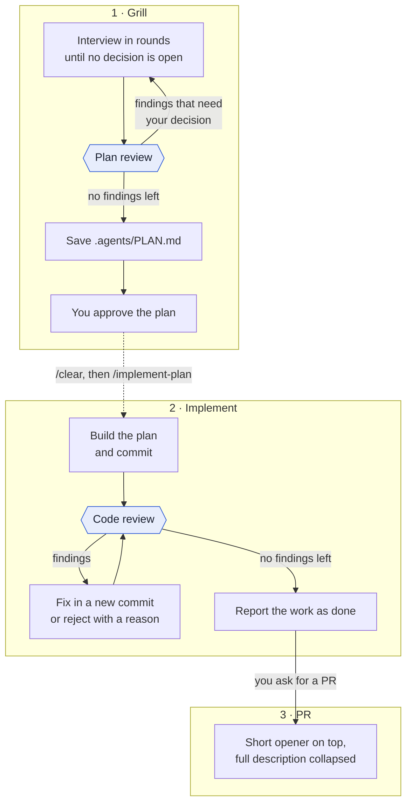

# ai-plugins

A plugin marketplace for AI coding assistants — **Claude Code** and **GitHub Copilot** (VS Code & CLI).

## Available plugins

### [nuff-skills](./plugins/nuff-skills)

Set of skills that are good enough to improve your day-to-day AI workflow (initially, a fork of [mattpocock/skills](https://github.com/mattpocock/skills)): grilling, domain modeling, adversarial review and pull request descriptions.

The workflow is three steps: **grill** the idea into a plan, **implement** it, open the **PR**. Before you see the plan or the finished code, a model from a different provider reviews it in a loop until it has no findings left.

| Step | You run | What happens |
| ---- | ------- | ------------ |
| Grill | `/grill-me` | The agent interviews you until no design decision is open, keeping your `CONTEXT.md` and ADRs up to date. The **plan review loop** runs on its own, then the plan is saved to `.agents/PLAN.md` for your approval. |
| Implement | `/clear`, then `/implement-plan` | The agent builds the plan and commits it. The **code review loop** runs before the work is reported as done. |
| PR | ask the agent to open a PR | `pr-description` writes a short opener with the agent's full description collapsed below it. |

**Clear the context once**, after approving the plan: `.agents/PLAN.md` holds everything the implementation needs. Don't clear during grilling, because open decisions live only in the conversation until the plan is saved.

See the [nuff-skills README](./plugins/nuff-skills/README.md) for the review loops, the reviewer models and the full list of skills.

### nuff-hooks-cc / nuff-hooks-copilot

Good enough guardrail hooks, one plugin per platform: [nuff-hooks-cc](./plugins/nuff-hooks-cc/README.md) for Claude Code, [nuff-hooks-copilot](./plugins/nuff-hooks-copilot/README.md) for GitHub Copilot CLI. Install only the one matching your agent.

- reads only from the Workspace, `D:\` (Windows only) and the roots you list in `~/.nuff-hooks.json` (plus the agent's home dirs and the temp dir)
- writes only to the Workspace (plus Trash, the agent's home dirs and the temp dir)
- file removals are rewritten into moves to Trash: `D:\.slop-trash` on Windows, `~/.slop-trash` on Linux and macOS

Works on Windows (with the `py` launcher), Linux and macOS (with `python3`); needs Python 3.10+.

### nuff-cc

Good enough mods for **Claude Code only**. First mod: open the current session's folder in VS Code from an **Open in VS Code** button above the prompt (desktop app) or `/vscode`.

See the [nuff-cc README](./plugins/nuff-cc/README.md) for details.

### [nuff](./plugins/nuff) (deprecated)

> [!WARNING]
> **nuff is deprecated.** Its four-phase Azure DevOps pipeline (Refine → Plan → Code → Improve, with `/do.nuff` and `/do-everything.nuff`) turned out to be too heavy for day-to-day work. It has been replaced by [nuff-skills](#nuff-skills), which keeps the useful parts (sharpening the plan with you, independent review of plan and code) in three lightweight steps.

The plugin is still listed in the marketplace for existing users. See the [nuff README](./plugins/nuff/README.md) for its documentation.

## Installation

### Claude Code (CLI)

1. Open Claude Code and navigate to the Plugins section via `/plugin`
2. Add `nuff-plugin` as new marketplace
3. Browse marketplace plugins and install desired ones (e.g. nuff-skills)

To update plugins installed from the marketplace, use `/plugin` command to check for updates and apply them. You can also manage plugins (e.g. uninstall, view details) from the same interface.

### GitHub Copilot CLI

1. Open Copilot CLI
2. See available commands via `/plugin`
3. Install plugin marketplace via `/plugin marketplace add nuff-plugin`
4. Install desired plugins from the marketplace, e.g. `/plugin install nuff-skills@nuff-plugin`
5. To update plugins installed from the marketplace, use `/plugin update nuff-skills@nuff-plugin` to check for updates and apply them.

### GitHub Copilot Chat in VS Code

As of 2025-03-13, Chat Plugins as in Preview and Plugins Marketplace is an experimental feature and needs to be enabled manually in VS Code settings.

1. Open User settings via `Ctrl+P` and `> Preferences: Open User Settings`
2. Search for `chat plugin`
3. Enable ` Chat > Plugins: Enable` setting
4. Add `nuff-plugin` as new marketplace in the `Chat > Plugins:Marketplaces`

Once done, you can go to Extensions view and search plugins via `@agentPlugins` filter, e.g. `@agentPlugins nuff-skills` to find the nuff-skills plugin and install it.

Plugins should be updated as standard VS Code extensions as per [microsoft/vscode: Test: plugin support](https://github.com/microsoft/vscode/issues/301158).

If that doesn't work, you can go to plugin folder and pull the latest changes from GitHub via `git pull` to update the whole marketplace and get the latest version of the plugins.
