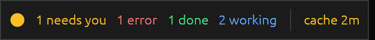
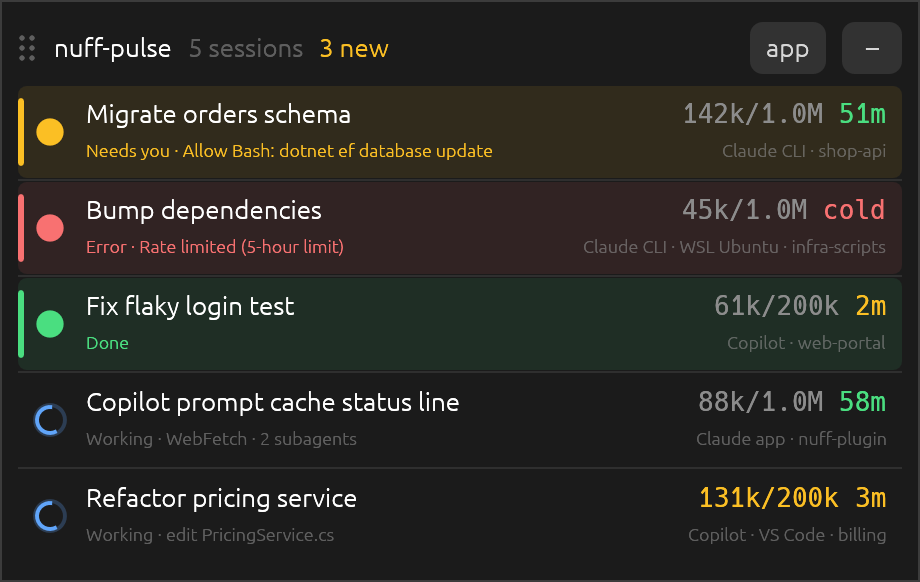
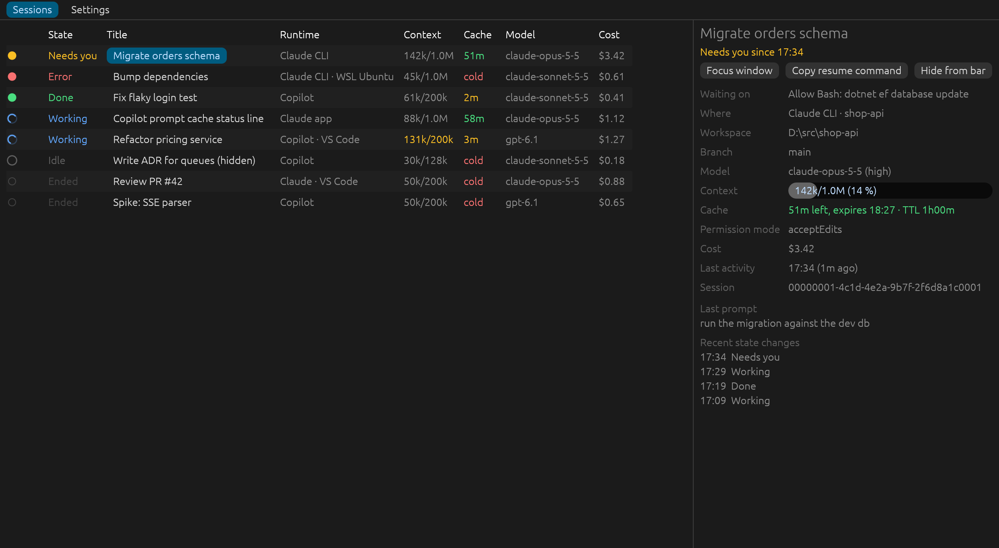

# nuff-pulse

A small Windows widget that lists your active local agent sessions from Claude Code and GitHub Copilot, with their state (Working, Needs you, Done, Error), context size and prompt-cache countdown.

Windows 10 or 11 (x64). Claude Code and Copilot CLI sessions inside WSL are listed too.

The floating bar, collapsed to a pill and expanded to the session list:





The app window, with every session of the day and the selected one's details:



<sub>Screenshots in the dark theme, with made-up sessions. The app window is shown without its Windows title bar.</sub>

## Install

1. Download `nuff-pulse-<version>-windows-x64.zip` from the [nuff-plugin releases](https://github.com/filip-be/nuff-plugin/releases) (tags `apps/nuff-pulse/v*`). Each zip has a `.sha256` file next to it.
2. Extract it to a folder of your own, for example `%LOCALAPPDATA%\Programs\nuff-pulse`, and run `nuff-pulse.exe`. The bar appears in the top-right corner and an icon appears in the tray. There is no installer.
3. Optional: tick **Start with Windows** in the tray menu.
4. Recommended: install the hook plugin of each agent you use. They make Needs you, Done and Ended exact; without them the widget infers these from the session logs. Both come from the `nuff-plugin` marketplace (`filip-be/nuff-plugin`) and need Python 3.10+ (the `py` launcher on Windows, `python3` in WSL):
   - Claude Code: `/plugin marketplace add filip-be/nuff-plugin`, then `/plugin install nuff-pulse-cc@nuff-plugin`.
   - GitHub Copilot: in Copilot CLI, `/plugin marketplace add filip-be/nuff-plugin`, then `/plugin install nuff-pulse-copilot@nuff-plugin`. The GitHub Copilot app and VS Code's Copilot agent host load Copilot CLI plugins too.

   For agents inside WSL, install the plugin in the agent that runs in the distro.

The exe is not code-signed, so SmartScreen may warn the first time; **More info → Run anyway** starts it.

To update, quit the widget from the tray menu and replace `nuff-pulse.exe`. To uninstall, untick Start with Windows, quit, and delete the folder, `%APPDATA%\nuff-pulse` (settings) and `%USERPROFILE%\.nuff-pulse` (hook files).

## Using it

- **Floating bar**: borderless, always on top, drag it anywhere (grab it by any part, rows included); its position is remembered per monitor layout. It hides while a full-screen app is in front. Two modes: a **pill** (counts and the most urgent cache countdown) and a **list** (one row per active session: state ring, title, state · activity, context, cache countdown, runtime and workspace). Click the pill to expand it; `–` in the list collapses it. Right-click a row and choose **Hide until active** to take a stale session off the bar: it comes back by itself with its next activity (a hidden session raises no alert; hiding is not kept across restarts). **Win+Alt+P** (configurable) toggles pill ↔ list.
- **Zoom**: hold **Ctrl** and turn the mouse wheel over the bar or the app window to make text and windows bigger or smaller (10 % per notch, 50–300 %); **Ctrl+0** resets it. Both windows share one zoom, kept in the settings file as `zoom`. A bar in the right half of its monitor grows to the left.
- **Click a row** to clear its alert and bring its window to the front: Windows Terminal, VS Code (the window whose title has the workspace folder), the GitHub Copilot app or the Claude app. Any other host is left alone rather than focusing a wrong window. WSL sessions are matched by window title.
- **Tray icon**: a badge with the number of alerts, blinking while a session needs you. Left click shows or hides the bar; the menu has Show bar, Open app, Settings, Start with Windows and Quit.
- **App window** (`app` on the bar, or the tray): today's sessions with state, title, runtime, context, cache, model and cost, and a detail pane (workspace, branch, model, context meter, cache expiry, subagents, permission mode, last prompt, recent state changes, Focus window, Copy resume command, Hide from bar / Show on bar). Hidden sessions are marked “(hidden)”. Cost is in dollars: for Claude the list-price total Claude Code records (notional on a subscription), for Copilot the GitHub AI credits used at $0.01 each.
- **Settings** (`%APPDATA%\nuff-pulse\settings.toml`, edited in the app window): hotkey, zoom, extra roots (folders read besides the defaults, optionally polled), context window per model-name prefix. Start with Windows adds or removes an `HKCU\…\Run` entry; it is off by default.
- **WSL**: the `~/.claude`, `~/.copilot` and `~/.nuff-pulse` folders of each *running* distro are read through `\\wsl.localhost\<distro>\` and polled every 5 s; the list of running distros is refreshed every 30 s. Stopped distros are never started.

Only one widget runs per Windows session; starting it again shows the bar.

For checking the core against real sessions, the binary can also print what it sees:

```powershell
cargo run --release -- --dump
```

```powershell
cargo run --release -- --watch
```

## What it reads

| Source | Files |
| ------ | ----- |
| Claude Code | `~/.claude/projects/<enc-cwd>/<id>.jsonl` (transcripts), `~/.claude/sessions/<pid>.json` (status) — `CLAUDE_CONFIG_DIR` is honoured |
| GitHub Copilot (CLI, app, VS Code Agent Host) | `~/.copilot/session-state/<id>/events.jsonl`, `workspace.yaml`, `inuse.<pid>.hold` — `COPILOT_HOME` is honoured |
| Hook plugins | `~/.nuff-pulse/sessions/<runtime>-<id>.hooks.jsonl`, written by the `nuff-pulse-cc` and `nuff-pulse-copilot` plugins, which document the format |

The widget works without the hook plugins, with less precise state: Done is then inferred from the log and its alert waits 3 s for further activity.

It only reads session files, except for deleting hook files of sessions that ended more than 24 hours ago (or that were untouched for 7 days).

## Resources

Measured with `tools/measure.ps1` on a Windows 11 machine with Intel integrated graphics (8 logical cores), release build:

| | Private memory | CPU (one core) |
| --- | --- | --- |
| No sessions (`-Idle`), WSL distro running | 75 MB | 0.3 % |
| ~20 sessions of the day, one working, bar as a list | 87 MB | 1.4 % (the ring turns 4 times a second) |
| Same, app window open | 90 MB | 1.2 % |

The exe is 4.6 MB. Most of the memory is the graphics driver's: the widget draws with OpenGL, and on this machine its OpenGL contexts alone take about 65 MB; reading and tracking the sessions takes about 7 MB (`nuff-pulse --watch`). The app window is created once, hidden, and shown on demand: destroying and recreating it leaked about 5 MB of driver memory per cycle. While idle the widget wakes every half second to check its files and every 5 s to list the folders of running WSL distros, which is most of its idle CPU.

## Development

```powershell
cargo test
```

```powershell
cargo clippy --all-targets -- -D warnings
```

Test fixtures in `tests/fixtures/` are sanitized real sessions: `tools/probe.py --fixtures` (Claude) and `tools/fixtures_copilot.py` (Copilot) write them with text replaced by `<str:N>`, ids remapped and times shifted.

```powershell
pwsh tools/measure.ps1 -Idle
```

`tools/measure.ps1` stops a running widget, starts the release build and reports its private memory, CPU and exe size (`-App` opens the app window; `-Idle` starts it with empty home and settings folders, so only running WSL distros are read: stop their agents, or the distros, for a no-session figure).

## Releasing

CI (`.github/workflows/nuff-pulse.yml`) checks formatting (`cargo fmt --check`) and runs the tests, clippy and a release build on every change to the widget or its hook plugins. To release:

1. Set `version` in `Cargo.toml`, run `cargo build` so `Cargo.lock` follows, rename `## Unreleased` in `CHANGELOG.md` to `## <version>` and commit all three. CI builds with `--locked` and the release job needs that CHANGELOG section, so a tag without them fails before anything is published.
2. Push a tag `apps/nuff-pulse/v<version>`. CI checks that the tag matches `Cargo.toml`, builds the exe and publishes a GitHub release with `nuff-pulse-<version>-windows-x64.zip` (exe, README, CHANGELOG, licence), its SHA-256 and the CHANGELOG section as notes.
