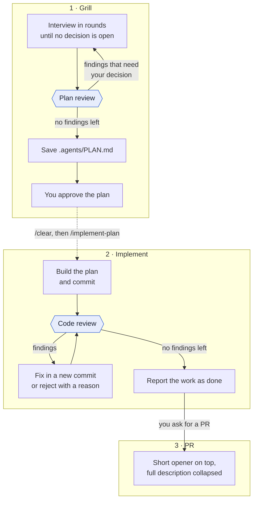

# nuff-skills

Set of skills that are good enough to improve your day-to-day AI workflow: sharpen the plan with you, build it, and open the pull request, with an independent review of both the plan and the code before you see them.

## Workflow

Three steps: **grill**, **implement**, **PR**.

1. **Grill.** Run `/grill-me`. The agent interviews you in rounds until no design decision is left open. It looks up facts itself and asks you only for decisions. Domain terms and decisions go into your project's `CONTEXT.md` and ADRs as they come up. When nothing is left open, the plan review starts on its own. Once it ends, the plan is saved to `.agents/PLAN.md` and you approve it.
2. **Implement.** Run `/clear`, then `/implement-plan`. The agent builds the plan and commits it. The plan's last step runs the code review, before the work is reported as done.
3. **PR.** Ask the agent to open a pull request. `pr-description` then runs on its own and writes the description; it also runs whenever the agent edits one.

### Review loops

Both reviews start automatically, and both are loops.

| When | Mode | How the loop runs |
| ---- | ---- | ----------------- |
| Grilling has no open questions left, before the plan is presented | `plan` | Findings already settled are dropped, facts are looked up by the agent, and real decisions come back to you as another grilling round. Your answers go back to the reviewer. |
| Implementation is finished, before it is reported as done or a pull request is opened | `code` | Each finding is fixed in a new commit or rejected with a reason. The reviewer re-checks every fix and rejection. |

A loop ends when the reviewer has no findings left. If the agent and the reviewer still disagree and neither has a new argument, those findings are marked **Open** and handed to you with both positions.

The reviewer is read-only and comes from a different model provider, run through GitHub Copilot CLI at high reasoning effort:

| Agent's own model | Reviewer |
| ----------------- | -------- |
| GPT | `claude-opus-5.5` |
| Claude, Gemini or other | `gpt-6.2-sol` |

If Copilot CLI is missing or fails, the agent stops and asks you to fix it and retry, use one of its own subagents as the reviewer, or skip the review.

### When to clear the context

Clear once: after you approve the plan, before `/implement-plan`. `.agents/PLAN.md` holds everything the implementation needs.

Don't clear during grilling. Open decisions exist only in the conversation until the plan is saved.

### Pull request description

A short opener of one to three sentences says what the change is for. Below it, the agent's full description is folded into a `
` block labelled with the model that wrote it, with screenshots when the change has a visible result. A repository's pull request template takes precedence.

## Skills

| Name | Description | Auto-discovered |
| ---- | ----------- | --------------- |
| grill-me | Grilling session that also builds your project's domain model, sharpening terminology and updating CONTEXT.md and ADRs inline. Saves the approved plan to `.agents/PLAN.md` and ends it with the code review as its final step. | No |
| grilling | Interview the user relentlessly about a plan, decision, or idea until every branch of the design tree is resolved and the plan has passed adversarial review. The reusable interview primitive behind grill-me. | Yes |
| domain-modeling | Actively build and sharpen a project's domain model — challenge terms against the glossary, stress-test with edge-case scenarios, and update CONTEXT.md and ADRs inline. | Yes |
| challenge-domain-model | Challenge existing domain model, CLAUDE.md/AGENTS.md and README files structure | No |
| adversarial-review | Independent review of a plan or of finished code by a model from a different provider (via GitHub Copilot CLI) when available, else a host subagent, looped until no real gaps remain or only deadlocked disagreements are left for the user. grilling runs it before presenting the plan; grill-me puts the code review in the plan as its final step. | Yes |
| pr-description | Write pull request descriptions as a short opener with the full agent-written text collapsed below it in a `
` block labelled with the model's name. | Yes |
| implement-plan | Implement the plan defined in `.agents/PLAN.md` (e.g. one written by grill-me). | No |

Skills that are not auto-discovered run only when you invoke them, e.g. `/grill-me`.
