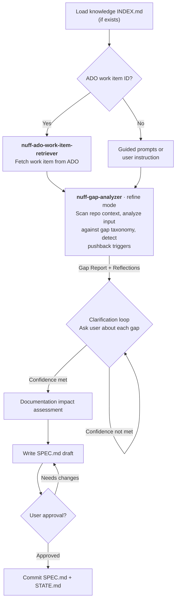
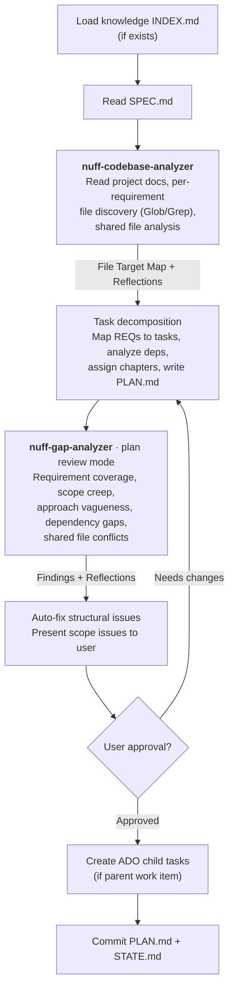
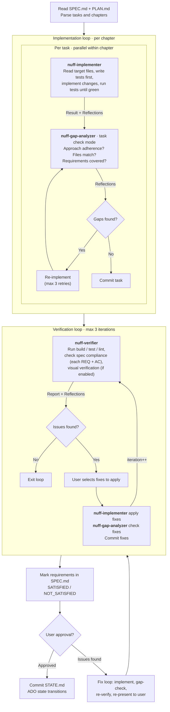
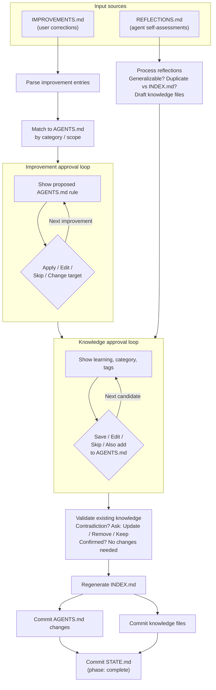

# nuff

> Take an Azure DevOps work item and do _enough_ work to get it done.

**nuff** is an AI-powered workflow plugin that turns Azure DevOps work items into implemented, verified code through a structured four-phase pipeline. It works with both **GitHub Copilot** (VS Code & CLI) and **Claude Code**.

## Principles

### Azure DevOps is the source of truth

Requirements live in Azure DevOps. nuff picks up work items from there and starts a conversation with you to clarify, plan, and implement them. You don't duplicate requirements elsewhere — ADO is where they're defined and managed.

### One conversation, start to finish

Each work item flows through Refine → Plan → Code → Improve as a single, continuous conversation. nuff uses interactive prompts to keep you in the loop at every step, so context is never lost between phases.

### Self-checking at every phase

nuff doesn't just produce output and move on. Every phase runs a gap analysis on its own results — checking for ambiguities, missing coverage, scope issues, and logical gaps. If something doesn't look right, it asks you before proceeding.

### Verification-first

Code isn't done until it's verified against the spec. After implementation, nuff runs up to three verification-and-fix iterations, checking builds, tests, linting, and spec compliance. Only verified code gets marked as complete.

### Pushback on scope

The gap analyzer actively flags vague requirements, scope creep, contradictions, and missing edge cases. nuff would rather ask you a clarifying question than silently make an assumption.

### You decide, the tool assists

Every phase produces an artifact (SPEC, PLAN, verification report) that requires your explicit approval before moving forward. nuff does the heavy lifting, but you make the calls.

### Platform-portable

nuff targets both GitHub Copilot and Claude Code, optimizing for each platform's constraints — request budgets, context window sizes, model availability, and agent spawning mechanics. Workflows and skills are shared across platforms, but execution details (model routing, subagent invocation, token management) adapt to get the best results within each harness's limits.

### Compound learning

Each work item should make the next one easier. Every sub-agent self-assesses its work, recording pitfalls, patterns, and tooling discoveries as reflections. The Improve phase distills these into durable knowledge files in `.nuff/knowledge/` that future Refine and Plan phases consult — creating a learning loop where the team's accumulated experience compounds over time.

## How it works

```
Azure DevOps Work Item
        │
        ▼
   ┌─────────┐     Clarify requirements,
   │  Refine │ ──► identify gaps, produce SPEC.md
   └────┬────┘
        │  ✓ User approves spec
        ▼
   ┌─────────┐     Decompose into tasks,
   │   Plan  │ ──► map to files, produce PLAN.md
   └────┬────┘
        │  ✓ User approves plan
        ▼
   ┌─────────┐     Implement tasks, verify against spec,
   │   Code  │ ──► fix issues, mark SPEC.md requirements
   └────┬────┘
        │  ✓ Code verified
        ▼
   ┌─────────┐     Review reflections + lessons learned,
   │ Improve │ ──► update AGENTS.md and knowledge base
   └─────────┘
```

**Refine** — Fetches the work item from ADO, runs gap analysis on the requirements, asks you clarifying questions, and produces a `SPEC.md` with numbered requirements and acceptance criteria.

**Plan** — Analyzes the codebase to map requirements to specific files, decomposes work into ordered tasks grouped by execution chapters, and produces a `PLAN.md`.

**Code** — Implements tasks chapter-by-chapter, commits each one, then runs verification against the spec. Issues are fixed iteratively (up to 3 rounds) until everything passes.

**Improve** — Processes two sources of learning: user corrections (`IMPROVEMENTS.md`) and agent self-assessments (`REFLECTIONS.md`). User corrections are applied to `AGENTS.md` files as concise rules. Agent reflections are distilled into knowledge files in `.nuff/knowledge/` — categorized as patterns, pitfalls, conventions, or tooling discoveries. Existing knowledge is validated against session findings, and contradictions are flagged for review. Skipped automatically if neither source has content.

All artifacts are stored in `.nuff/<item-name>/` alongside a `STATE.md` that tracks phase progress, decisions, and session history.

## Phase details

### Refine

Clarify requirements, identify gaps, and produce an approved SPEC.md.



**Subagents:**

- `nuff-ado-work-item-retriever` — fetch work item from ADO
- `nuff-gap-analyzer` [refine mode] — scan repo, find gaps, pushback triggers

**Outputs:**

- SPEC.md
- REFLECTIONS.md (from gap-analyzer)
- STATE.md updated

### Plan

Analyze the codebase, decompose requirements into tasks, and produce an approved PLAN.md.



**Subagents:**

- `nuff-codebase-analyzer` — file discovery per requirement
- `nuff-gap-analyzer` [plan review mode] — validate plan against spec

**Outputs:**

- PLAN.md
- REFLECTIONS.md (from both subagents)
- STATE.md updated
- ADO child tasks (if parent work item)

### Code

Implement tasks chapter-by-chapter, verify against the spec, and get user approval.



**Subagents:**

- `nuff-implementer` — one per task, parallel within chapter
- `nuff-gap-analyzer` [task check mode] — lightweight post-implementation check
- `nuff-verifier` — bulk verification after all tasks complete

**Outputs:**

- Committed code
- SPEC.md (with requirement markers)
- REFLECTIONS.md (from all subagents)
- STATE.md updated

### Improve

Process user corrections and agent reflections into AGENTS.md rules and knowledge files.



**Subagents:** None (orchestrator handles directly)

**Skills:**

- `nuff-knowledge` — file format, categories, INDEX.md conventions
- `ask-user` — all approval prompts
- `nuff-self-improvement` — captures corrections during any phase

**Cross-phase skills** (used by the orchestrator throughout all phases):

- `nuff-progress-sync` — synchronizes runtime progress visualization with STATE.md
- `nuff-ado-update` — updates ADO work item state and adds nuff-prefixed comments on transitions
- `nuff-state-update` — applies structured STATE.md mutations consistently across commands and workflows
- `nuff-ado-orchestration` — coordinates ADO fetch, task creation, transitions, and artifact posting

**Outputs:**

- Updated AGENTS.md files
- `.nuff/knowledge/` entries
- Regenerated INDEX.md
- STATE.md marked complete

## Quick start

```
/do.nuff 12345
```

That's it. Pass a work item ID (or URL, or let nuff detect it from your branch name) and it walks you through the full workflow.

### Autonomous mode

```
/do-everything.nuff 12345
```

Runs the full Refine → Plan → Code → Improve pipeline end-to-end without any user interaction. Designed for cloud agents, CI pipelines, and batch processing scenarios.

In autonomous mode, nuff self-answers every decision point using built-in heuristics and logs each decision with its reasoning to the STATE.md session log. The AI stays vigilant — it questions its own choices before committing and will emit `[AUTONOMOUS-BLOCKED]` and stop cleanly if a situation is genuinely ambiguous rather than silently making a wrong assumption.

Gap analyzer findings are still logged and printed for full observability, but they don't block execution. Verification failures after the maximum fix iterations are marked `[AUTONOMOUS-UNRESOLVED]` and reported at the end rather than halting the run.

### Direct phase access

To jump into a specific phase:

```
/do.nuff 12345 --phase refine    # Just clarify requirements
/do.nuff 12345 --phase plan      # Just create an implementation plan
/do.nuff 12345 --phase code      # Just implement (needs existing SPEC + PLAN)
/do.nuff 12345 --phase improve   # Just run the improve phase
```

Or run the improve phase directly as a standalone command:

```
/improve.nuff 12345
```

### Configuration

```
/configure.nuff --show           # See current settings
/configure.nuff                  # Interactive wizard
/configure.nuff models.implementer=opus  # Set a specific value
```

nuff uses a single config file: `.nuff/config.json` in your repo. **This file must exist before running any workflow** — if it's missing, the orchestrator will prompt you to create one via `/configure.nuff`. You can start from the built-in defaults or customise everything from scratch. The config file is git-ignored by default (`.nuff/.gitignore`), so each developer maintains their own settings.

Model selection is per-subagent, with phase-level granularity where a subagent runs across multiple phases:

```json
{
  "models": {
    "gap_analyzer": {
      "refine": "opus",
      "plan": "opus",
      "code": "sonnet"
    },
    "codebase_analyzer": {
      "plan": "sonnet"
    },
    "implementer": "sonnet",
    "verifier": "sonnet",
    "ado_work_item_retriever": "haiku",
    "ado_process_retriever": "haiku"
  }
}
```

Available aliases: `haiku`, `sonnet`, `opus`, `gpt-mini`, `gpt-standard`, `gpt-codex`, `gemini`

The config is validated against the current schema version on load — if the schema has changed, nuff will offer to update your config automatically.

## Platform support

nuff is designed to work across two AI coding platforms:

| Platform           | Interface     | Setup                                                                                                                                             |
| ------------------ | ------------- | ------------------------------------------------------------------------------------------------------------------------------------------------- |
| **Claude Code**    | CLI           | [Claude Code extensions docs](https://docs.anthropic.com/en/docs/claude-code)                                                                     |
| **GitHub Copilot** | VS Code + CLI | [Copilot extensions docs](https://docs.github.com/en/copilot/using-github-copilot/using-extensions-to-integrate-external-tools-with-copilot-chat) |

## Agents under the hood

nuff delegates specialized work to focused subagents. The orchestrator (`do.nuff`) consults workflow skills and spawns subagents as needed — there are no separate "phase agents" like `nuff-refiner` or `nuff-planner`. Each phase is driven by the orchestrator itself, which spawns only the task-focused subagents listed below.

| Subagent                         | Phases             | Config key                       | Role                                                             |
| -------------------------------- | ------------------ | -------------------------------- | ---------------------------------------------------------------- |
| **nuff-gap-analyzer**            | refine, plan, code | `models.gap_analyzer.*`          | Self-checks output for gaps, scope issues, and pushback triggers |
| **nuff-codebase-analyzer**       | plan               | `models.codebase_analyzer.plan`  | Scans repo to map requirements to files                          |
| **nuff-implementer**             | code               | `models.implementer`             | Implements a single task from PLAN.md                            |
| **nuff-verifier**                | code               | `models.verifier`                | Runs build/test/lint and validates spec compliance               |
| **nuff-ado-work-item-retriever** | refine             | `models.ado_work_item_retriever` | Fetches and normalizes work items from Azure DevOps              |
| **nuff-ado-process-retriever**   | orchestrator       | `models.ado_process_retriever`   | Queries ADO for process template and available state transitions |

## MCP integrations

- **Azure DevOps** — Fetch work items, create child tasks, manage state transitions

## Artifacts

For each work item, nuff creates a `.nuff/<item-name>/` directory containing:

| File              | Phase  | Description                                                       |
| ----------------- | ------ | ----------------------------------------------------------------- |
| `STATE.md`        | All    | Phase tracking, decisions, session log                            |
| `SPEC.md`         | Refine | Requirements with acceptance criteria                             |
| `PLAN.md`         | Plan   | Tasks, files, dependencies, execution chapters                    |
| `IMPROVEMENTS.md` | Any    | User corrections captured during the session; consumed by Improve |
| `REFLECTIONS.md`  | All    | Agent self-assessments from sub-agents; consumed by Improve       |

Additionally, nuff maintains a shared knowledge base at `.nuff/knowledge/`:

| Path                           | Description                                                       |
| ------------------------------ | ----------------------------------------------------------------- |
| `.nuff/knowledge/INDEX.md`     | Auto-generated summary of all knowledge entries (token-efficient) |
| `.nuff/knowledge/patterns/`    | Reusable codebase patterns discovered during work                 |
| `.nuff/knowledge/pitfalls/`    | Non-obvious gotchas and problems to avoid                         |
| `.nuff/knowledge/conventions/` | Project conventions discovered during work                        |
| `.nuff/knowledge/tooling/`     | Tool and environment discoveries worth remembering                |

Knowledge files are git-tracked and shared with the team. The Refine and Plan phases load the knowledge index to inform gap analysis and codebase exploration.

## License

MIT
